

  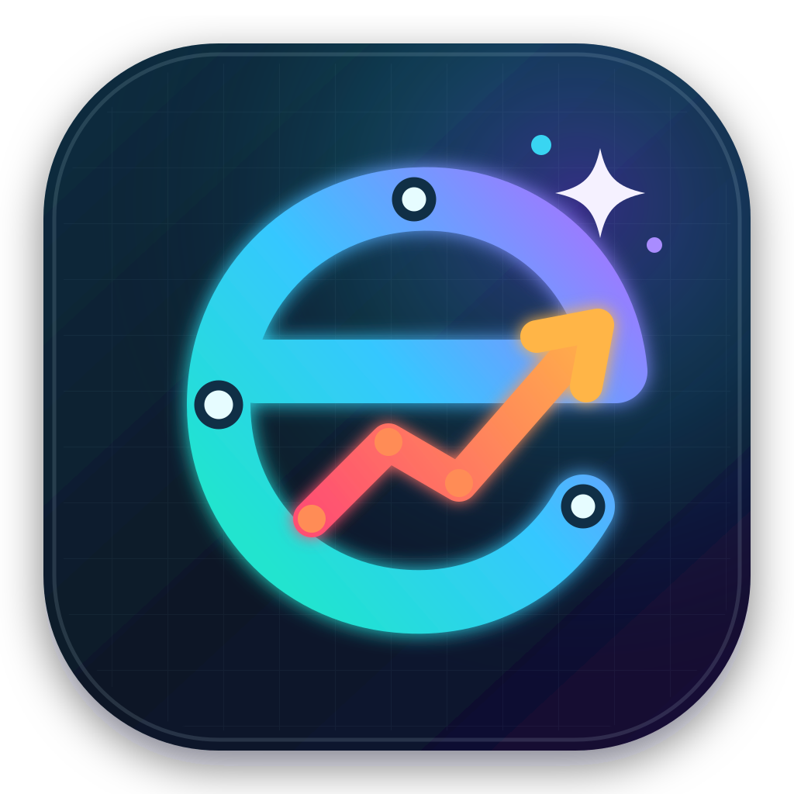

<h1 align="center">easy-stock：中国 A 株市場のための AI リサーチワークベンチ</h1>

<strong>市場の発見、個別株のリサーチ、ポートフォリオの点検、AI によるポートフォリオの最適化のための、ローカルファーストのデスクトップのワークベンチ</strong>

<a href="./README_EN.md">English</a> | <a href="./README.md">简体中文</a> | 日本語

  AI に市場を本当に理解させ、すべての判断を根拠までたどれるようにします。 
  場中の観察、引け後の振り返り、長期的な洞察を、絶えず進化し続ける 1 つのリサーチのシステムにまとめます。

  <a href="https://github.com/jundizhou/easy-stock/releases/latest"><strong>ダウンロード</strong></a> ·
  <a href="#なぜ-easy-stock-なのか">なぜ</a> ·
  <a href="#主な機能">主な機能</a> ·
  <a href="#ai-が-a-株のリサーチをどう強化するか">AI ができること</a> ·
  <a href="#ai-ネイティブのアーキテクチャ">アーキテクチャ</a> ·
  <a href="#はじめに">はじめに</a> ·
  <a href="https://github.com/jundizhou/easy-stock/discussions">Discussions</a> ·
  <a href="./CONTRIBUTING.md">コントリビュート</a> ·
  <a href="#ライセンス">ライセンス</a>

  
  
  
  
  
  
  
  

---

## なぜ easy-stock なのか

AI 時代の株式の端末は、古い相場アプリにチャット欄を後付けしただけのものであってはなりません。

従来の相場ソフトは、価格、騰落、売買代金を表示するのは得意です。A 株の取引で本当に難しいのは、数字の裏にある構造を理解することです。今日の主なテーマは何か？ テーマは広がっているか？ ストップ高の連続（連板）の段は上に伸びたか？ 昨日の最強の銘柄は翌日も続伸したか？ トレンドはまだ崩れていないか？ 市場のセンチメントは回復しているのか、それとも衰えているのか？

easy-stock は、この言葉を話す AI ネイティブのワークベンチです。相場、テーマ、ストップ高の銘柄群、ニュース、引け後の振り返りを、1 本のローカルファーストのリサーチのパイプラインにまとめます。

| AI ネイティブの機能 | easy-stock での実現方法 |
| --- | --- |
| **市場を感じ取る** | Kaipanla、Eastmoney、Sina、Cailianpress などの情報源を集約し、相場、K 線（ローソク足）、テーマ、ストップ高、ニュースを 1 つの統一されたモデルにします |
| **構造を理解する** | トレンド、テーマ、連板の段、センチメント、出来高と価格、相対的な強さを、計算できるドメインモデルに変えます |
| **タスクを実行する** | 定期的なジョブ、組み込みのブラウザー、記事を見つけ、重複を除き、保管し、意見を抽出するエージェント |
| **記憶を築く** | 記事、要約、センチメントの履歴、分析の記録、モデルのセッション、リサーチのキャッシュを、あなたのマシンに保存します |
| **結論を検証する** | 採点の観点、テーマの出典、元の URL、タイムスタンプ、劣化の状態を残すので、どの結論も根拠までたどれます |

> easy-stock があなたの代わりに判断することはありません。より良い知覚、より速いリサーチ、そして時間とともに積み重なる判断のシステムを提供します。

> **注意：** アプリの UI とドキュメントは、現在は中国語が中心です（製品は中国 A 株市場を対象としていて、データソースと市場の仕組みが強くローカライズされているためです）。英語へのローカライズは[ロードマップ](./ROADMAP.md)にあります。コードベース、アーキテクチャ、この README は英語でも読めるようになっています。

---

## 主な機能

> [v1.5.0](https://github.com/jundizhou/easy-stock/releases/tag/v1.5.0) と比べて、現在の main ブランチには、ニュースと決算開示の根拠の評価、ポートフォリオの最適化の復旧、スコアの表示の修正が含まれています。これらの修正は v1.5.0 のインストーラーには含まれていません。

市場の発見から、個別株のリサーチ、ポートフォリオの見直し、監視までの主な流れをたどってください。どのスクリーンショットもクリックすると原寸で表示されます。相場とスコアはインターフェースを示すためのもので、データによって変わります。

<table>
  <tr>
    <td width="50%" align="center"><strong>AI ダッシュボード</strong> 市場のシグナル、日々のタスク、ポートフォリオの健全性 <a href="./docs/assets/readme-ai-dashboard-2026-11.webp">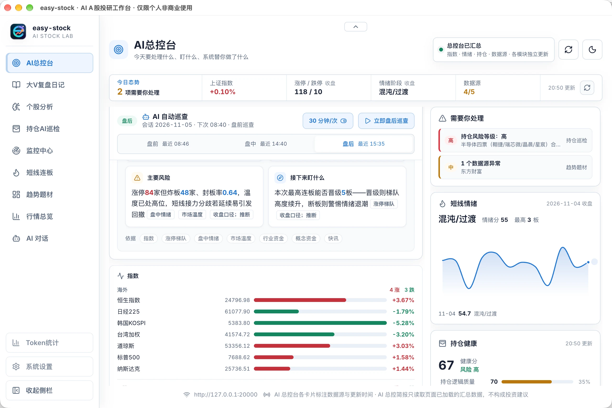</a></td>
    <td width="50%" align="center"><strong>個別株の分析</strong> リサーチの結論、根拠、スコア <a href="./docs/assets/readme-stock-analysis-2026-11.webp">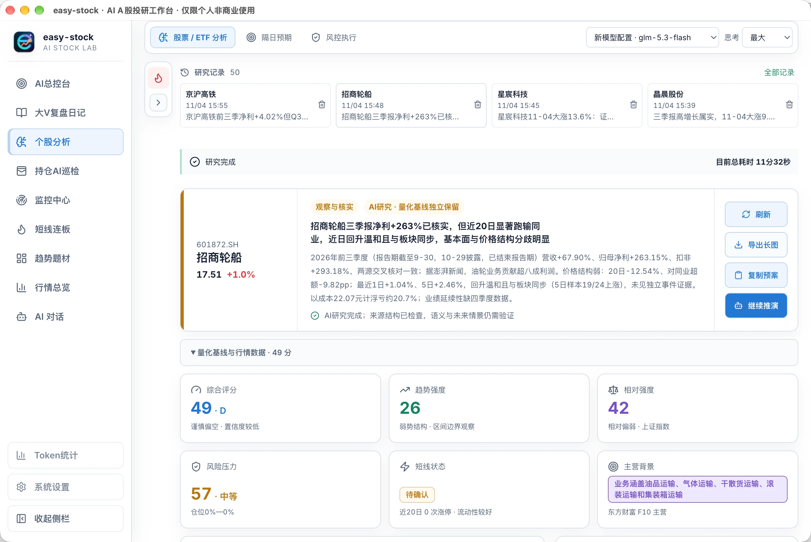</a></td>
  </tr>
  <tr>
    <td width="50%" align="center"><strong>ポートフォリオの AI 点検</strong> 4 つの採点の観点とリスクのチェック <a href="./docs/assets/readme-portfolio-inspection-2026-11.webp">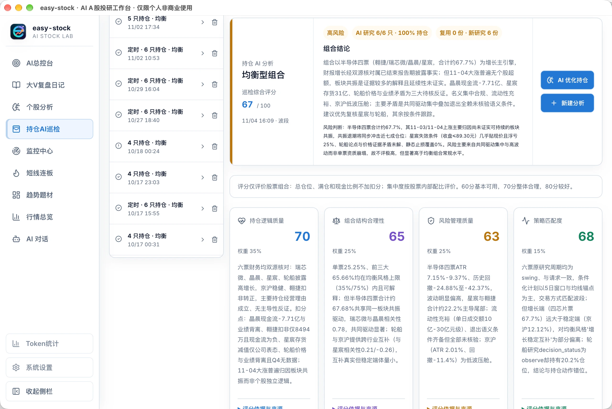</a></td>
    <td width="50%" align="center"><strong>AI によるポートフォリオの最適化</strong> 現在の保有と提案された保有の比較 <a href="./docs/assets/readme-portfolio-optimization-2026-11.webp">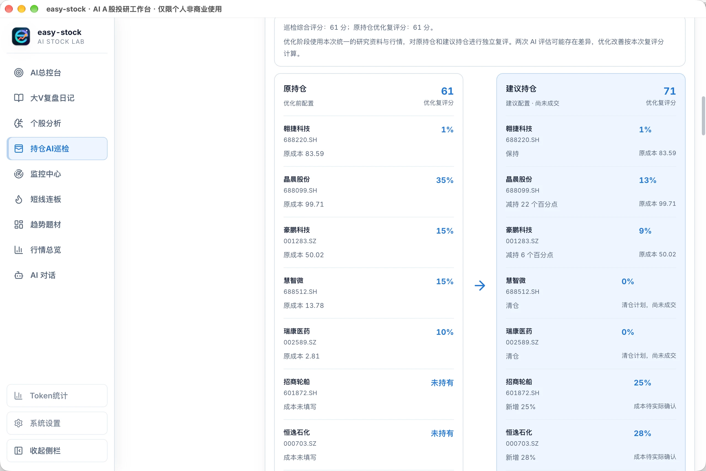</a></td>
  </tr>
  <tr>
    <td width="50%" align="center"><strong>監視センター</strong> ウォッチリスト、リスクのアラート、監視のルール <a href="./docs/assets/readme-monitor-2026-11.webp">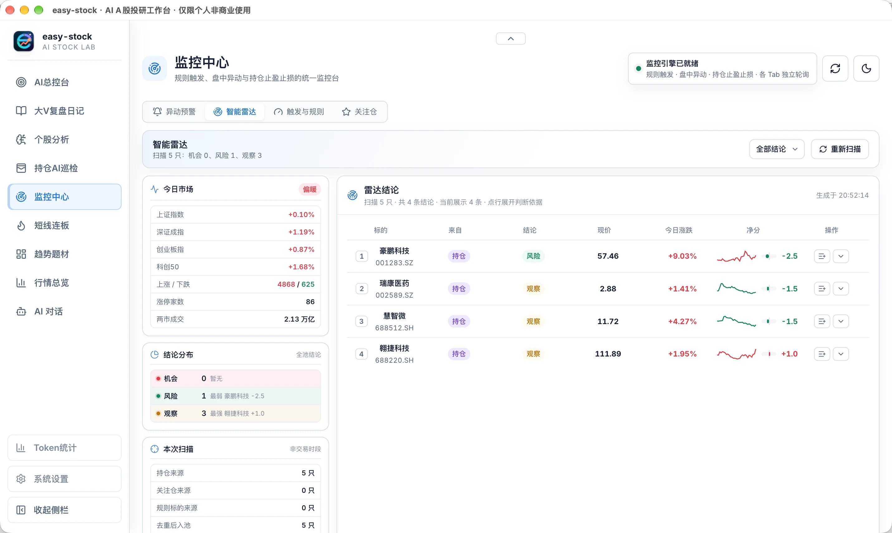</a></td>
    <td width="50%" align="center"><strong>連板の段</strong> センチメントの履歴、ストップ高の段、続伸の状況 <a href="./docs/assets/readme-short-term-2026-11.webp">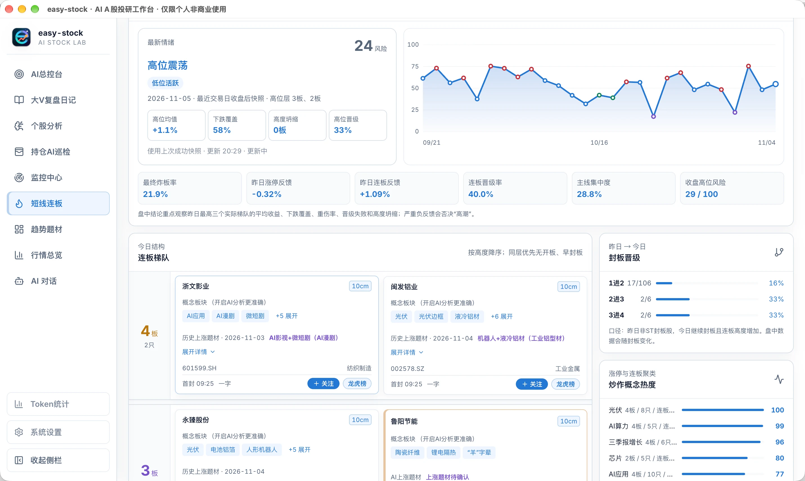</a></td>
  </tr>
  <tr>
    <td width="50%" align="center"><strong>テーマレーダー</strong> 主導するテーマ、銘柄の段、価格のチャート <a href="./docs/assets/readme-theme-radar-2026-11.webp">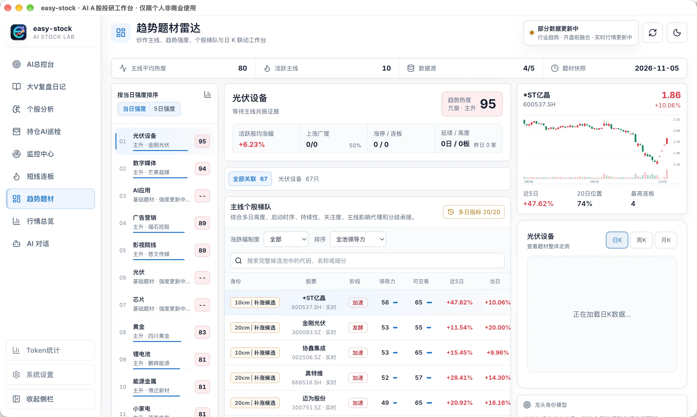</a></td>
    <td width="50%" align="center"><strong>市場の概況</strong> ニュース、テーマのシグナル、資金の流れのランキング <a href="./docs/assets/readme-market-overview-2026-11.webp">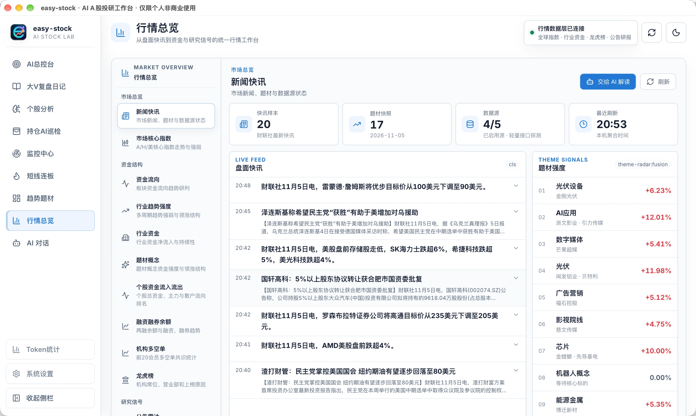</a></td>
  </tr>
  <tr>
    <td width="50%" align="center"><strong>引け後の振り返りの自動化</strong> 筆者の記事の同期、取り込み、保管 <a href="./docs/assets/easy-stock-auto-review.png">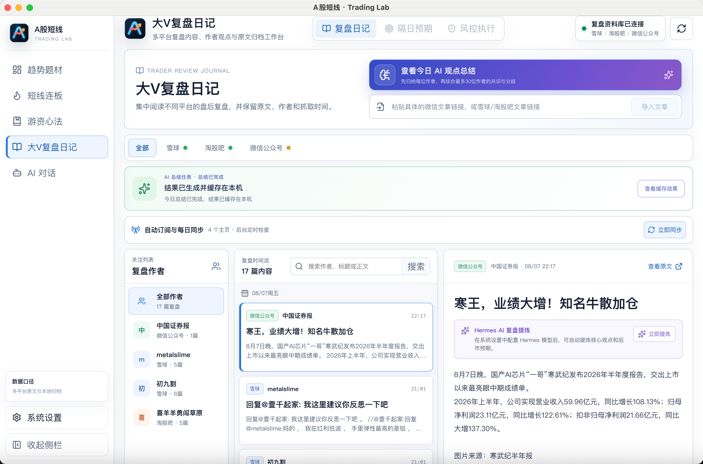</a></td>
    <td width="50%" align="center"><strong>AI チャット</strong> モデルとの会話とリサーチのタスク <a href="./docs/assets/easy-stock-ai-copilot.jpg">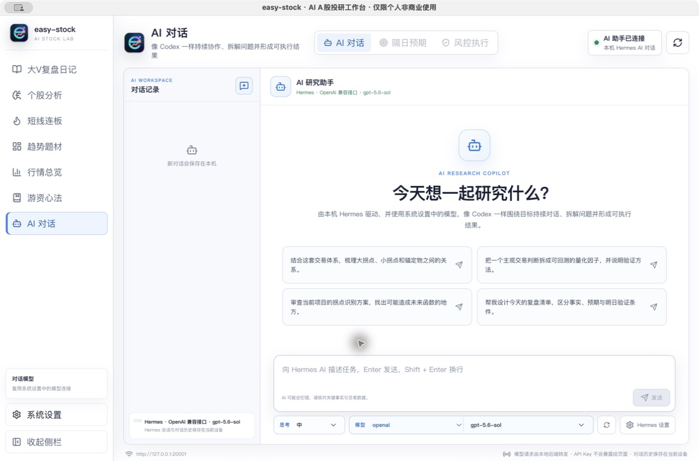</a></td>
  </tr>
</table>

下の詳しい説明では、トレードの知恵のライブラリも扱っています。

<strong>すべての機能の説明を展開する</strong>

### 01 · 引け後の振り返りの自動ダイジェスト

#### 複数の市場の書き手が実際に言ったことを、AI に集めて整理させる

A 株の著名な評論家による引け後の振り返りは、Xueqiu、TaoGuba、WeChat に散らばっています。それぞれのプロフィールを手で訪ね、今日の記事を絞り込み、本文をコピーするのは時間の無駄です。easy-stock は、そのすべてを 1 つの統一された振り返りのタイムラインに整理します。

  

収集が終わると、ワンクリックで「今日のコンセンサス」のレポートを作れます。共通して注目している分野、主な意見の違い、市場の事実、次の取引日に確かめるべき条件を抽出します。

**定期的な振り返り** は深セン証券取引所のカレンダーを使い、各取引日の前の暦日に、デフォルトでは **北京時間の 22:00** に実行されます（変更できます）。記事の対象期間は、直近に完了した大引けから予定の時刻までです。Feishu と DingTalk の一方または両方を選ぶと、Markdown の完全な分析を受け取れます。すべての筆者の見解を含みますが、記事の本文と根拠の詳細は含みません。長いレポートは自動で分割されます。アプリを起動したままにしてコンピューターをスリープさせず、事前に記事を同期しておいてください。実行できなかった回の取り戻しは、対象の取引日の 09:30 より前にだけ行われ、実行中の振り返りがあればその終了を待ちます。カレンダーは毎日更新され、障害の間は、キャッシュ済みの完全な月を最大 7 日間使えます。使えるカレンダーがない場合、スケジュールは一時停止して再試行します。

  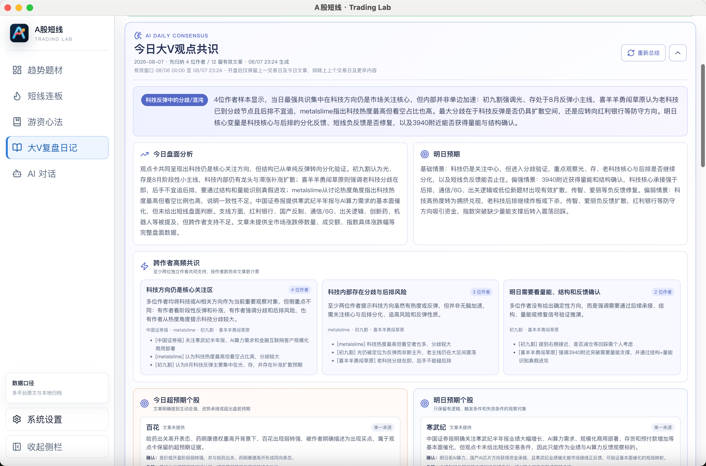

目的は「明日何が上がるかを AI に当てさせること」ではなく、何十本もの構造化されていない記事を、読みやすく検証でき、追い続けられる意見の地図に変えることです。

### 02 · 連板の段とセンチメントのサイクルの分析

#### 連板の段、上の段に進む割合、そしてセンチメントのサイクルのどこにいるかを見る

A 株の値幅制限は、市場区分や銘柄の状態によって異なります。連板の段を読むこと、つまり何銘柄がストップ高に達し、何日連続で続き、どの段で崩れたかを読むことは、短期の市場分析の中心です。easy-stock は、ストップ高の銘柄群、連続ストップ高の段、昨日の続伸の状況、上の段に進む割合、センチメントの履歴を 1 つの画面にまとめ、センチメントのサイクルの段階を判定する組み込みのアルゴリズムも備えています。

  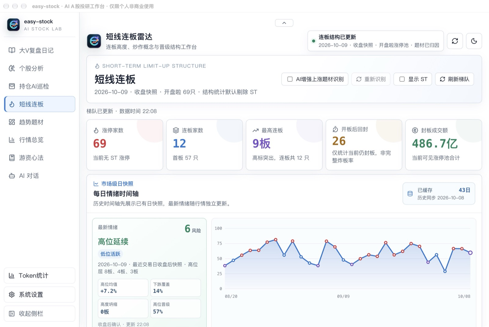

### 03 · テーマレーダー

#### セクターの動きから、市場で本当に主導しているテーマを見極める

テーマのランキング、勢いの強さ、資金の流れ、市場の広がり、連続の期間を集約し、テーママップを通じて産業チェーン、コンセプトのノード、細分化された方向性に分解します。さらに、市場のトレンド、テーマの段階、トレンド銘柄の条件付きのエントリーポイントについての AI の読みを組み合わせます。

テーマ指数の日足、週足、月足のローソク足と出来高で、セクター全体を追えます。インターフェースでは、データ提供元の指数と、均等加重の参考指数を区別しています。

  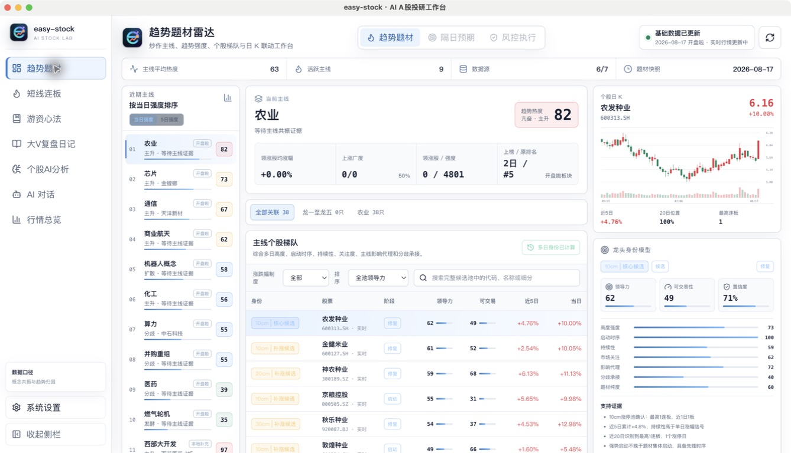

テーマ指数のローソク足の例を見る

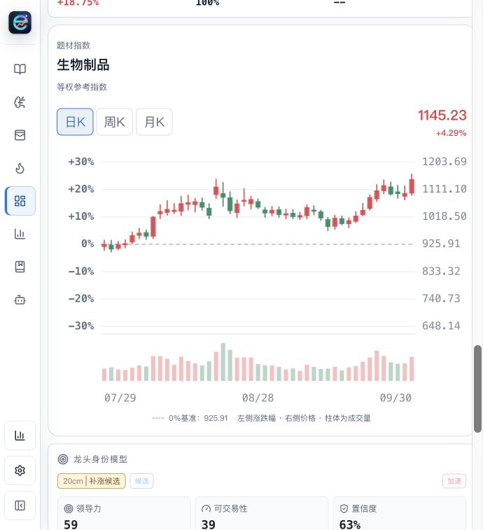

### 04 · 市場の概況

#### 指数、資金の流れ、ランキング、リサーチのシグナルを、たどれる 1 枚の地図に

主要な指数、ニュース速報、業種のトレンドの強さ、セクターの資金の流れ、テーマ、個別株の資金の流入・流出、竜虎榜、開示のレーダー、機関投資家の見解、業界のリサーチを、1 つのリサーチの入口にまとめます。どのページもデータソースと取得時刻を残しているので、相場の端末とニュースのページを行き来する代わりに、今の文脈をそのまま AI に渡して解釈させられます。

  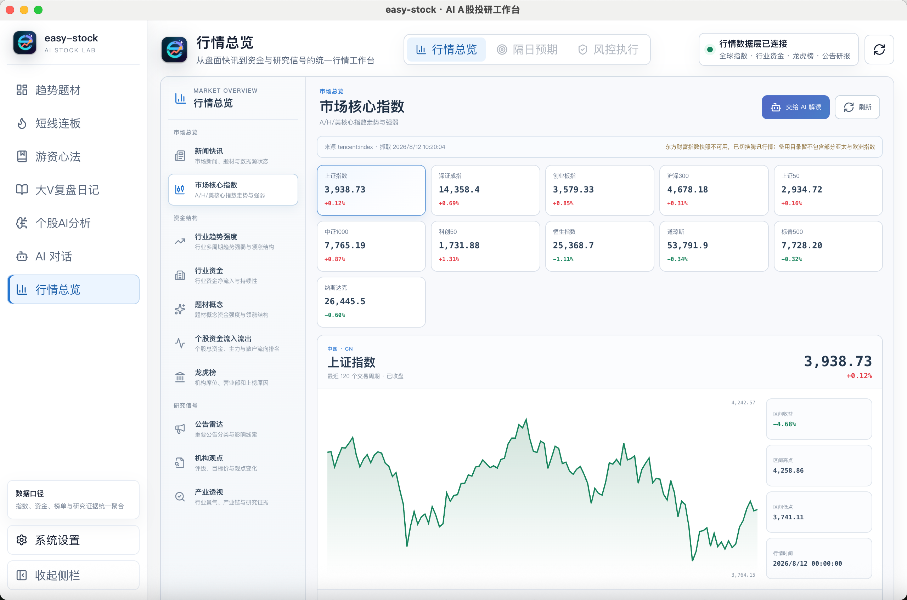

  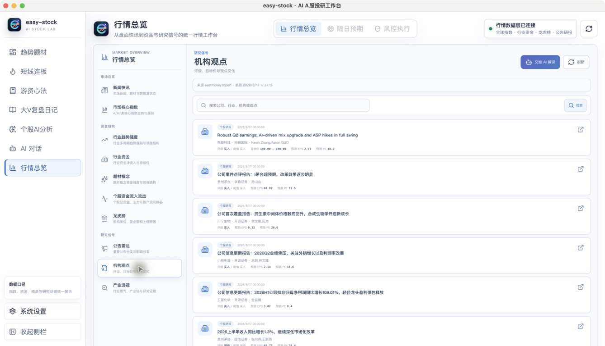

### 05 · 段階的な個別株のリサーチ

#### リサーチの目的、期間、深さを選ぶ

観察、新しく持つかもしれないポジション、既存の保有のいずれかを選び、短期、スイング、中期のどれかの期間を選びます。既存の保有では、取得コストの入力は任意です。

| リサーチのモード | 用途 |
| --- | --- |
| **定量のプレビュー** | AI のモデルを呼ばずに、価格、トレンド、定量のベースラインを確認します |
| **簡易の AI 評価** | 主な投資の論点と、確認が必要な疑問をまとめます |
| **標準の AI 評価** | 事業の推進力、カタリスト、裏付けとなる根拠、反証を比べます |
| **詳細な AI リサーチ** | 中心となる意見の違いをさらに調べ、シナリオとその後の確認事項を組み立てます |

レポートは、出典の記述、第三者の意見、リサーチによる推論を区別します。事業の論点、意見の違い、反証、確認の条件、無効になる条件とあわせて、引用と根拠のタイムスタンプを残します。完了したリサーチの段階は保存され、復旧の条件を満たせば再開できます。

  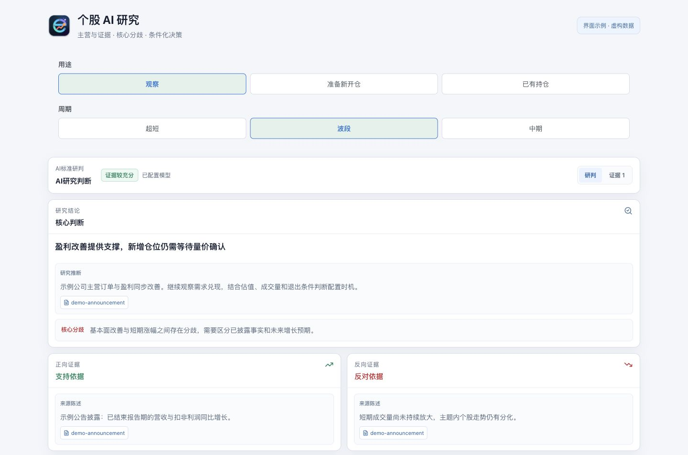

### 06 · ポートフォリオの AI 点検

#### 個別のリサーチを、ポートフォリオ全体の文脈の中で評価する

複数のポートフォリオのプランを保存できます。設定フォームの上の **+** をクリックしてプランを追加し、プランを切り替えて、それぞれの銘柄、ウェイト、取得コスト、リサーチの設定を編集します。プランは名前の変更や削除ができ、変更はローカルに保存されます。

DingTalk と Feishu のロボットの設定は、個別株の AI リサーチと、手動のポートフォリオ点検の通知に対応しています。どちらも根拠や出典の詳細を除いた Markdown の完全な結果を送り、長いレポートは自動で分割します。失敗のアラートを有効にすると、失敗または未完了のタスクは状態と得られた結果を送り、レポートのないタスクは状態の説明を送ります。

各プランは、3 日ごと、毎週、毎月、または N 日 / 週 / 月ごとの **定期的な点検** に対応していて、開始日と実行時刻を北京時間で指定できます。DingTalk と Feishu の一方または両方を選ぶと、設定で有効にしたロボットを通じて Markdown の完全な点検結果を受け取れます。根拠と出典の詳細は除かれ、長いレポートは番号付きのメッセージに分割されます。どちらも選ばなければ、レポートは保存されるだけです。失敗のアラートは、システムの通知の設定に従います。スケジュールは、一緒に保存された保有とリサーチの設定を使うので、プランを変えた後はスケジュールを保存し直してください。アプリを起動したままにして、コンピューターをスリープさせないでください。実行できなかった回は 1 回の取り戻しの点検にまとめられ、実行中の点検は次の点検が始まる前に終わり、月末を超える月ごとの日付はその月の最終日になります。プランを削除すると、その後の定期的な点検は止まります。

積極的、バランス、安定のスタイルを選び、保有期間を決め、最大 10 銘柄を追加します。総資産のデフォルトは 50 万元で、編集できます。取得コストは、銘柄を追加したときに取得した有効な相場がデフォルトになり、上書きできます。株数（単元）は資産、ウェイト、取得コストから見積もられ、フォームには現在の価格、時価、銘柄ごとと合計の損益が表示されます。割り当てていない資金は現金のまま残ります。点検では **過去 24 時間以内の有効な AI の個別株レポート** を再利用し、足りない銘柄をリサーチして、ポートフォリオの結論を出します。個別株のリサーチは、別に更新することもできます。

ポートフォリオの設定を見る：プラン、資産と損益、取引のスタイル、ウェイト、取得コスト

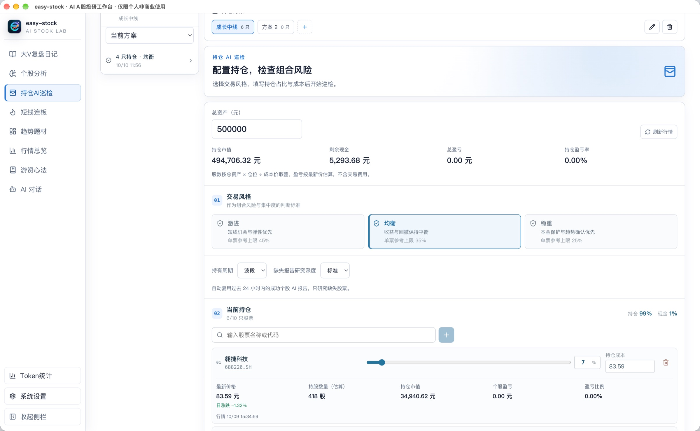

設定のスクリーンショットは、保存したプランを示しています。上部に時価、残りの現金、損益があり、その下に取引のスタイル、リサーチの設定、銘柄ごとのウェイトと取得コストが続きます。株数と時価は、入力と相場にもとづく見積もりです。

AI が 4 つの採点の観点を説明し、アプリケーションがその固定ウェイトの合計を再計算して検証します。**保有の論点 35%、ポートフォリオの構造 25%、リスク管理 25%、戦略との適合 15%** です。採点では株式のポートフォリオそのものを評価します。フルインベストメントかどうか、現金の割合、全体のエクスポージャーは加点も減点もせず、集中度は株式のポートフォリオの中でのウェイトを使います。

  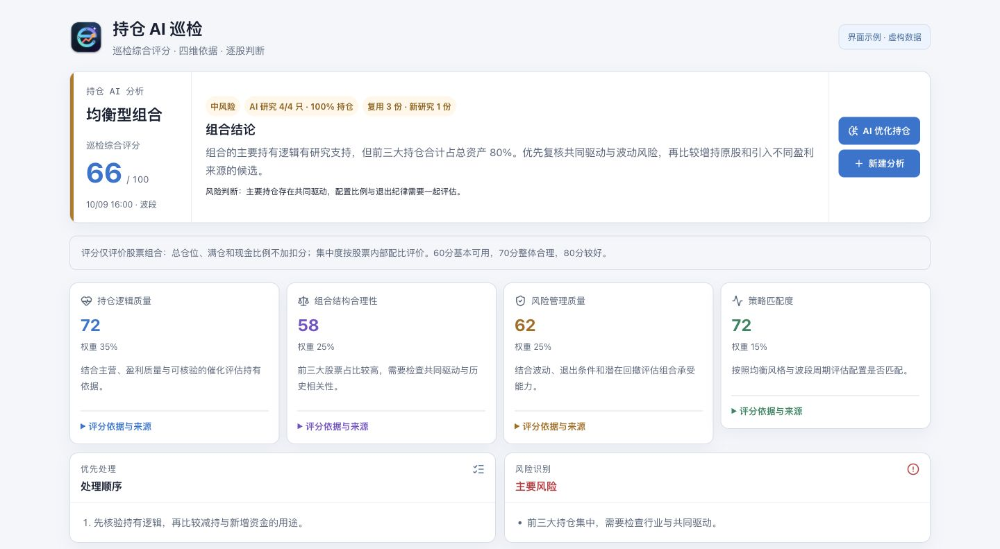

示している点検は 4 つの保有を対象とし、3 つのレポートを再利用して、1 銘柄を新たにリサーチしています。スコアは 65 で、リスクは中程度です。4 枚のカードで、保有の論点、ポートフォリオの構造、リスク管理、戦略との適合を説明し、採点の根拠と出典を展開して見られます。

レポートには、銘柄ごとの判断、共通の推進力、過去の相関、リサーチの出典、確認と無効の条件も残ります。既存の個別株レポートはそのまま開けます。タスクはバックグラウンドで実行され、レポートと復旧の状態はローカルに保存されます。

### 07 · AI によるポートフォリオの最適化

#### 元のポートフォリオと提案されたポートフォリオを比べ、資金がどこに向かうかを説明する

点検のレポートから最適化を始めます。候補の選別、個別株のリサーチ、投資の比較、配分の探索、独立したレビューによって、目標のウェイト、資金の出どころ、エントリーとエグジットの条件が作られます。このプロセスでは、既存の保有を買い増すことと、新しい銘柄を加えることを比べます。

- **資金の制約：** 株式の全体のエクスポージャーと現金は固定されたままです。累計の入れ替えは、最適化の連鎖の最初の株式の配分の 70% までで、新しい銘柄は最大 2 つ、目標の保有は最大 10 です。
- **対になったレビュー：** 元のポートフォリオと提案されたポートフォリオは、同じ根拠と市場のスナップショットを使って独立に採点されます。改善の度合いは、そのレビューのスコアを使います。先の点検のスコアは別に扱われ、2 つの AI の評価は異なることがあります。
- **実質的な改善：** 投資の価値、構造、取引の適格性、リスクの制約をまとめて確認します。スコアが高いだけでは提案の条件を満たしません。結果は、条件付き、条件を満たす代替案、または調整なしになることがあります。
- **進捗の保存：** 個別株の判断、投資の比較、レビューのブロックは別々に保存されます。復旧では足りない作業を続け、やり直しても有効なリサーチを再利用できます。

  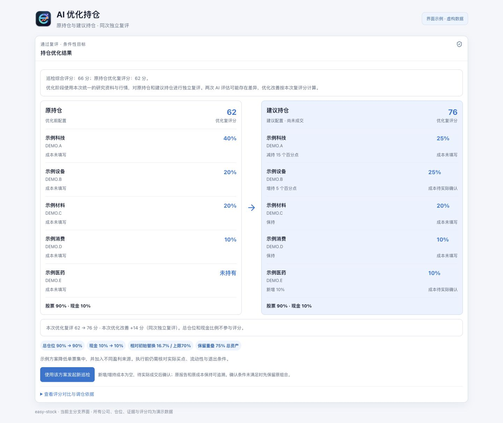

スクリーンショットでは、元の点検のスコア 65 を残しつつ、最適化のレビューのスコアを別に示しています。元の保有が 64、提案が 74 で、対になったレビューでは 10 ポイントの改善です。並べた表示では、減らすもの、ウェイトが変わらないもの、増やすものが示されます。エントリー保留の通知は、目標の実現に価格などの条件を満たす必要があることを意味していて、提案された配分はまだ実行されていません。

提案を適用すると、その目標の保有について新しい点検が始まります。**注文を出したり、実際のポジションを変えたりすることはありません**。スコアは現在のリサーチの根拠を評価するもので、期待リターンや勝率ではありません。

### 08 · トレードの知恵のライブラリと AI コパイロット

#### 苦労して得たトレードの経験を、何度も読み返せる長持ちする知識に変え、AI にあなたのリサーチの仕方を学ばせる

  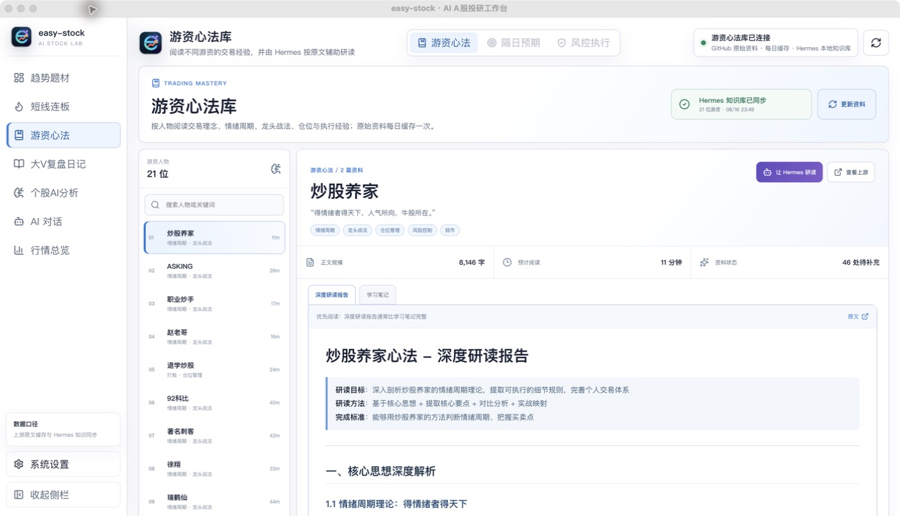

### 毎日のリサーチのループ

| 段階 | easy-stock が提供するもの |
| --- | --- |
| **場中の発見** | 市場の概況、トレンドのテーマ、リアルタイムの相場、テーママップ、連板の段、データソースの状態 |
| **個別株のリサーチ** | 定量のプレビューと段階的な AI リサーチ、事業の推進力、根拠と反証、条件、シナリオ |
| **ポートフォリオの点検** | 有効なレポートの再利用、4 つの観点の採点、集中と相関のリスク、銘柄ごとの判断、出典 |
| **ポートフォリオの最適化** | 候補の選別、投資の比較、配分の探索、対になったレビュー、条件付きの提案 |
| **引け後の振り返り** | センチメントのタイムライン、昨日の続伸の状況、昇段の構造、連板の段の分析 |
| **情報収集** | 評論家のプロフィールの自動同期、記事の取り込み、本文の整形、ローカルへの保管 |
| **AI による抽出** | 記事ごとの要約、筆者ごとの統合、筆者をまたぐコンセンサス、意見の違い、次の取引日の注目の条件 |
| **長期的な蓄積** | 記事のライブラリ、トレードの知恵、個別株の分析の記録、AI のセッション、ローカルのリサーチの記憶 |

---

## AI が A 株のリサーチをどう強化するか

### 1.「データを見る」から「市場の構造を理解する」へ

easy-stock は、まずテーマ、段、ストップ高の理由、トレンド、相対的な強さ、センチメントの履歴をドメインモデルに整理し、その構造を AI に渡します。モデルが向き合うのは、ばらばらの数字ではなく、A 株の意味を持った市場の根拠です。

### 2.「手で見て回る」から「行動するエージェント」へ

デスクトップの Browser Bridge は、まず永続的な Electron のセッションを使って、購読している Xueqiu や TaoGuba のプロフィールを訪ね、記事を読みます。デスクトップのブリッジがない場合は、選んだエージェントが agent-browser を通じて内容を集められます。Go の振り返りのサービスが、メタデータを正規化し、重複を除き、保管して、記事を抽出します。

### 3.「単発の要約」から「意見のネットワーク」へ

システムは、まず各筆者の中心となる見解を統合し、次に筆者をまたいでその日のコンセンサスと意見の違いを集約します。市場の事実、少数派の見通し、共通の注目点、次の取引日に確かめるべき条件を分けて扱います。

### 4.「汎用のチャット」から「A 株のリサーチのコパイロット」へ

AI のセッションは、ローカルの共有のエージェントサービスを使い、Hermes か Codex を選べます。2 つのランタイムは、モデルのプロフィール、推論の設定、Skills、MCP の設定を共有しつつ、それぞれのネイティブのセッションは分けて保ちます。業務のタスクは、モデルの呼び出し、セッションの継続、ツール、タスクの文脈のために、それぞれのランタイムとモデルの設定を結び付けます。OpenAI、DeepSeek、Qwen、Moonshot、Anthropic、カスタムの互換エンドポイントを設定でき、Codex には Responses の接続が必要です。

### 5.「1 回きりの Q&A」から「長期的なリサーチのフライホイール」へ

| 知覚する | 理解する | 行動する | 記憶する | 検証する |
| --- | --- | --- | --- | --- |
| リアルタイムの相場、テーマ、記事 | AI が構造、見解、意見の違いを見極める | 自動の同期、分析、計画の下書き | ローカルの記事、履歴、セッション | 次の取引日に、価格と出典に照らして検証する |

検証のたびに、それが次のリサーチの文脈になります。時間がたつにつれて、システムにはデータが増えるだけでなく、あなたの仕事の仕方に合ったリサーチのプロセスと判断の蓄積ができていきます。

---

## AI ネイティブのアーキテクチャ

Go のバックエンドは、市場のデータを集め、定量のベースラインを計算し、根拠を整理して、業務のワークフローを実行します。共有のエージェントサービスは、アプリケーションの設定にもとづいて Hermes か Codex を選びます。データのサービスと AI の推論は別々の依存関係です。定量のプレビューにはモデルの呼び出しが不要で、詳細な個別株のリサーチでは、問いを組み立て、Go を通じて根拠を取得し、判断と条件を生成して、参照を検証します。

  <a href="./docs/assets/easy-stock-ai-architecture.svg">
    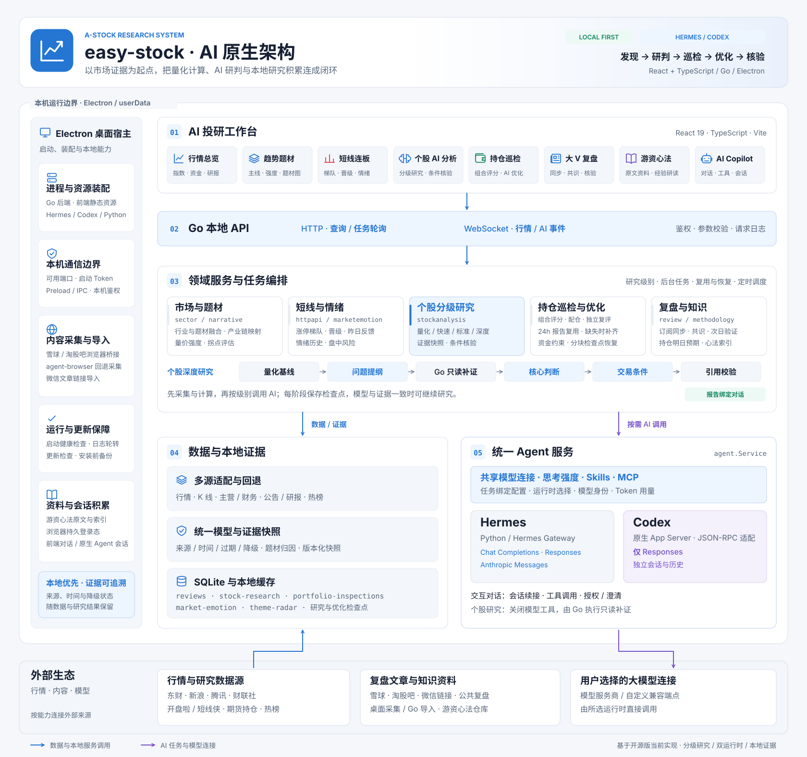
  </a>

| レイヤー | 役割 |
| --- | --- |
| **AI リサーチのワークベンチ** | React + TypeScript：市場の概況、トレンドのテーマ、連板の段、段階的な個別株のリサーチ、ポートフォリオの点検と最適化、振り返りのダイジェスト、トレードの知恵、AI コパイロット |
| **ローカルの Go API** | HTTP の問い合わせとバックグラウンドのジョブのポーリング、WebSocket による相場と AI のイベント、ローカルの認証、リクエストの検証、リクエストのログ |
| **ドメインサービスとオーケストレーション** | テーマの統合、段とセンチメントの計算、転換点の評価、個別株のリサーチ、ポートフォリオのレポートの再利用と採点、候補の選別と最適化のレビュー、見解のコンセンサス、翌日の検証、定期的な同期 |
| **データとローカルの根拠** | 情報源のアダプターとフォールバック、統一された市場のモデル、テーマの帰属、出典と時刻のメタデータを持つバージョン付きのスナップショット。SQLite には、振り返り、リサーチのジョブ、ポートフォリオの点検と最適化のチェックポイント、センチメントの履歴、テーマのキャッシュを保存します |
| **共有のエージェントサービス** | 共有のモデルのプロフィール、推論の設定、Skills、MCP。Hermes か Codex の選択。タスクに結び付けた設定、セッションの再開、承認、確認の質問、トークンの使用量。Codex はネイティブの App Server を使い、Responses の接続が必要です |
| **Electron のデスクトップのホスト** | 同梱の Go / Hermes / Codex / Python。ローカルのポートと起動のトークン。Preload / IPC。Xueqiu と TaoGuba の Browser Bridge、agent-browser へのフォールバック、WeChat のリンクの解析。ログ、更新、インストール前のバックアップ |
| **外部のエコシステム** | 市場とリサーチのデータソース、コンテンツのプラットフォーム、公開の振り返りのフィードとトレードの知恵、そして選んだランタイムが直接呼び出すモデルのプロバイダーや互換エンドポイント |

個別株のリサーチは段階ごとのチェックポイントを保存し、モデルの設定と根拠が一致していれば再開できます。ポートフォリオの点検は、まず 24 時間以内に完了した成功した個別株のレポートを再利用し、足りないリサーチを補ってからポートフォリオのレポートを作ります。ポートフォリオの最適化は、個別株の判断、投資の比較、レビューのチェックポイントを保存するので、復旧時には足りない作業を続けられます。[現在のアーキテクチャとコードの入口](./backend/docs/architecture.md)（中国語）をご覧ください。

---

## はじめに

### ユーザー向け

Node.js、Go、Python は不要です。[GitHub Releases](https://github.com/jundizhou/easy-stock/releases/latest) から、お使いの OS 向けのインストーラーかアーカイブを入手してください。

初回の設定（LLM の API キー、コンテンツの同期のための Xueqiu / TaoGuba へのログイン）については、[ユーザーガイド](./docs/user-guide.md)（中国語）をご覧ください。ローカルのスキルを追加・有効化するには、[スキルのインストールガイド](./docs/skill-installation.md)（中国語）をご覧ください。

### 開発者向け

ソースから実行、デバッグ、テスト、ビルドするには、[開発者ガイド](./docs/development.md)（中国語。アーキテクチャの図とコードは言語に依存しません）をご覧ください。

Settings → Notifications で、Feishu と DingTalk のカスタムのグループボットを、署名、キーワード、テストメッセージとともに設定します。設定方法と対応しているイベントについては、[通知の設定](./docs/notifications.md)（中国語）をご覧ください。

## コミュニティとコントリビュート

- 議論、リサーチの方法、活用事例：[GitHub Discussions](https://github.com/jundizhou/easy-stock/discussions)
- バグとデータの問題：OS、アプリのバージョン、再現の手順を添えて [issue を作成](https://github.com/jundizhou/easy-stock/issues/new/choose)してください
- 機能のリクエスト：場面と期待する結果を説明してください
- コードとドキュメントのコントリビュート：まず [コントリビュートガイド](./CONTRIBUTING.md) と [ロードマップ](./ROADMAP.md) をご覧ください
- 中国語でのチャット：[QQ グループ 422158208](https://qm.qq.com/q/lizlauc32U)
- セキュリティの問題：[セキュリティポリシー](./SECURITY.md) に従って非公開で報告してください

---

## ライセンス

easy-stock のオリジナルのバックエンド、フロントエンド、デスクトップアプリ、ドキュメントは、[PolyForm Noncommercial License 1.0.0](./LICENSE) のもとでライセンスされています。

- 個人の学習、研究、実験、そのほかの非商用の利用、変更、配布は、ライセンスと著作権の表示を残す限り許可されています。
- 本番環境へのデプロイ、有料のサービス、SaaS、有料のコンサルティングや研修、商用製品への組み込み、再販など、直接・間接を問わずあらゆる商用の利用には、作者から別途書面での許可を得る必要があります。
- サードパーティーの依存関係、データソース、同梱の素材は、それぞれ元のライセンスと利用規約に従います。
- easy-stock はソースを公開しているソフトウェアであり、OSI のオープンソースではありません。

---

## 免責事項

> このプロジェクトは、学習、研究、情報の整理のためだけのものです。投資の助言、リターンの約束、取引の根拠ではありません。市場にはリスクがあり、AI の出力とサードパーティーのデータは遅れたり、不完全だったり、誤っていたりすることがあります。必ず元の情報源で確認し、自分で判断し、自分の決定に責任を持ってください。

ローカルファースト · 根拠にもとづく · 主導権は人間に

