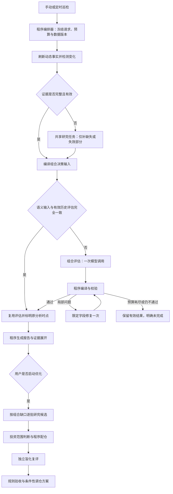

# 持仓巡检的 Token 与耗时优化方案

日期：2026-10-15。实施更新：2026-10-17。状态：已落地首批 P0 / P1 核心改动并完成离线验证，尚未开展真实模型成对评测。后续阶段仍按第 9 节分步推进。

目标是在保持股票 / ETF 混合组合评分质量、证据可追溯和交易约束的前提下，降低一次有效巡检的总成本与等待时间。范围覆盖持仓巡检，以及用户主动触发的持仓优化；两者分别统计和控制预算。普通巡检不自动启动调仓搜索。

建议采用**程序编排、按需研究、结构化共享记忆、一次组合判断、局部修复、独立复评**的 Agent 工作流。一个逻辑角色不必对应一次模型调用，也不必对应独立进程。先复用当前 Service、研究库和检查点，避免额外增加一个负责转述的 Supervisor 模型。

## 1. 现状与证据

本方案基于当前开源分支代码，以及本机数据库的只读抽样。未启动真实模型任务。以下为匿名单例观察，不是总体 P50 / P95；输入大小是应用记录的 UTF-8 字节，不等于模型 Token。

| 观察对象 | 已确认的记录 | 设计含义 |
| --- | --- | --- |
| 最近一次成功巡检 | 4 份股票 / ETF 报告全部复用；总耗时 1,065.8 秒，组合评估 1,065.3 秒 | 此例几乎全部时间在组合评估，优先优化这里 |
| 首轮组合评估 | 输入 157,623 字节，约 154 KiB；输出 17,607 字节；约 331 秒 | 已有研究仍以大量报告文字进入模型 |
| 第二轮组合评估 | 输入 176,278 字节，约 172 KiB；约 734 秒 | 一次修复占本次组合评估约 69% 时间 |
| 首轮输入组成 | holdings 约 82.4 KiB、facts 约 31.9 KiB、证据目录约 14.3 KiB、动作目录约 13.1 KiB | 报告、事实、目录需要统一压缩，不能只缩短提示词开头 |
| ETF 的持仓输入 | 单个 ETF 的研究与来源合计约 33.8 KiB | ETF 需要专用输入卡，重点保留方向、产品与溢价风险 |
| 首轮校验错误 | 包含风格枚举“偏离”（合法值为“匹配 / 部分偏离 / 明显偏离”）、非法引用、动作条件问题 | 部分协议错误引起了整份重写；不能把“偏离”擅自映射为某个风险判断 |
| 最近一次优化 | 记录从开始到完成约 47 分 31 秒；当前保存的 4 次方案 / 复评调用合计约 6 分 40 秒 | 这两个时间口径不同，不能将剩余时间全算成模型推理，或用差值证明某阶段耗时 |
| 优化依赖研究 | 6 只候选在该优化时间段内生成研究，多只单只约 6–8 分钟，研究等待并发上限为 2 | 新候选研究是另一条关键路径；最终记录中的 reused/new 可能受恢复影响，不代表任务全生命周期成本 |
| 优化局部修复 | 一次修复只输出 715 字节，仍输入 41,511 字节；另一次只修一个复评块，输入 47,199 字节 | 已有“局部输出修复”，还应缩小“修复输入” |
| Token 统计 | 现有记录按日期、模块、模型、运行时汇总，没有 job / stage / attempt 归属 | 当前无法准确给出上述单次任务的 Token 数，更不能承诺精确节省比例 |

当前已有的能力必须保留并复用：24 小时有效研究复用、共享运行中的研究任务、研究检查点、优化局部修复、程序配仓搜索、独立复评、统一冻结行情、有限重试。优化方案中这些不是新增收益。

还应先修复已确认的前后端版本不同步问题：后端复评 v36，前端仍接受 v35。有效方案被误判为旧版、显示“未生成”，容易诱发用户重复运行。展示兼容性问题不应消耗新的研究预算。

## 2. 目标工作流与角色边界

图中的修复回路由预算和次数约束，禁止无限循环。无变化的判断必须在动态事实刷新与事件检查之后进行，不能因为“报告不超过 24 小时”就直接跳过。

| 角色 | 实现方式 | 输入 / 输出与边界 |
| --- | --- | --- |
| 编排器 | Go 状态机 | 决定依赖、复用、预算、取消和恢复；默认不调用模型做任务规划 |
| 证据编译器 | 确定性代码 | 从完整研究提取阶段需要的事实、论点和引用，生成内容版本与依赖清单 |
| 研究 Worker | 现有股票 / ETF 研究流程 | 只补必要研究；同一语义任务单次执行，多消费者共享 |
| 组合评估器 | 默认一次模型调用 | 判断组合四维评分、主要冲突和行动选择；不得重查外部行情或重新写标的报告 |
| 规则校验器 | 确定性代码 | 校验完整性、引用、数值、动作归属、ETF 调整和硬性交易约束 |
| 修复器 | 代码优先，必要时小模型请求 | 只处理失败字段及依赖范围；不得改写无关的通过项 |
| 方案生成器 | 一次范围判断 + 程序求解 | 模型负责投资取舍，程序负责权重、资金配对和搜索 |
| 独立复评器 | 独立上下文的一次模型调用 | 对同批证据下的 A/B 配置作同口径比较，不接受提案方指定的分数或期望结论 |
| 报告渲染器 | 模板和前端 | 展示已有结构化判断、完整证据及动作；默认不增加“润色 Agent” |

组合的四个评分维度先保持一次联合判断。拆成四个 Agent 容易重复发送共同资料，并引入分组、风险与评分相互矛盾的问题；只有基准验证确实获益后再考虑拆分。

## 3. 将完整报告转为可复用的决策输入

### 3.1 三层存储

完整证据层保留原始快照、公告、行情、研究报告和真实引用，供审计与页面展开。决策输入层保存按用途提取的短卡，供模型调用。任务状态层保存节点依赖、调用记录、预算及已通过的输出块。压缩只发生在模型输入层，不删除原研究。

新增 `PortfolioAssetCard`，以确定性字段选择与去重为主，首期不为每只持仓额外调用一次“摘要模型”。卡片至少包含：

- 身份、类型、研究版本、来源时点、有效交易日、适用周期、覆盖程度和已知缺口。
- 主营 / 底层资产、关键持有逻辑、主要反证、催化条件、失效条件及各自证据编号。
- 当前组合相关的盈利与现金流事实、估值、趋势 / 波动、成本相关判断，区分可用、未知和不适用。
- 稳定的风险因子与角色标签；模型仍可提出有证据的新分组，标签不直接代替风险判断。
- 可选择动作及必要前提，具体展示文字由后端从原报告生成。

ETF 卡片单独保留跟踪指数、资产类别、集中度 / 与其他持仓重叠、杠杆或特殊结构、流动性、技术与消息判断、溢价及其基准时点。ETF 的适度分散加分沿用既有规则；行业高度集中、高溢价或流动性不足时，风险项仍必须完整进入评分。不能把“ETF”统一当低风险。

### 3.2 阶段化上下文

组合评估只读取全部持仓的决策卡、组合事实、必要的原始证据摘录和相关动作目录。标的报告里的长篇情景、重复解释、历史执行过程、与本次周期无关的交易讨论不重复发送。必需反证、重大事件、执行前提和资料缺失说明进入强制保留清单。

事实只存一份值和单位，其他字段用引用；引用目录使用本次快照绑定的短编号，映射表仍保留原内容哈希、report_id / source_id / fact。编号在同一评估和修复中固定，跨快照不得直接套用。相关性对称项只发送一次，计算定义统一保留。

动作目录只发送“动作类型、适用标的、必要前提与条件引用”的紧凑表示。后端掌握完整动作和约束，模型不能通过缩写解除条件，也不能自行创造价格。

上下文优先级按“对当前判断的必要性”确定，不能只按字数截断。高溢价、重大亏损、财报冲突等即使涉及低仓位标的，也不得因为优先级低被删掉。

首期软目标：4 只持仓的首轮输入从本例约 154 KiB 降至 24–40 KiB；10 只持仓按实际必要证据扩容。该目标用于检查重复内容，不是裁切风险证据的硬阈值。同时记录模型适配的 Token 估算与真实 usage；不以固定字节 / Token 比率做预算。

必要证据确实超预算时，编排器选择有界的补充证据步骤或标记覆盖不足，不静默丢证据。默认评估器仍禁用外部工具；后续如允许按编号读取补证，最多读取有限批次的本次冻结证据，不允许开放式搜索循环。

### 3.3 减少输出负担

模型返回四维评分及依据、风险条目、持仓结论、动作编号和必要条件。总分、仓位求和、ETF 调整、来源显示、动作展开、重复摘要和页面标题由程序生成。

每条解释给出长度与数量上限，详情从原证据展开。首期以本例输出从约 17–18 KiB 降到 6–10 KiB 为软目标，仍要求关键判断都有依据。不能为了输出短而删除负面信息或让解释变成空话。

## 4. 修复协议：冻结成功块，只修失败依赖

现有巡检修复会发送“完整基础输入 + 整份上次输出 + 全部错误”，再要求重写整份 JSON。改为保存可独立校验的块，例如评分维度、风险组、持仓动作和情景。

每次错误携带 `code / path / allowed_values / dependency_ids / owner`。区分模型格式错误、模型语义错误、输入缺失、后端编译错误和提供商传输错误。后端生成的动作文本缺陷应由程序处理，不能反复要求模型改一个它无权填写的字段。合并重复及派生错误，保留根因。

修复请求只发送失败块、允许值、相关证据和必要的跨块约束；返回限定路径的补丁并带上 `base_digest`。后端拒绝跨快照、越权路径和意外删除。合并后仍执行全局一致性校验。

涉及风险组或投资事实的改动会使依赖它的评分块失效，必须一并重评。不能机械保留已通过但语义前提发生变化的分数。无关块保持冻结，避免“修一个引用却重写四个分数”。

支持严格结构化输出的运行时使用明确的 JSON Schema / enum；其他运行时使用同一协议生成的简洁示例与校验器。适配器须确认能力，不假设所有提供商都支持结构化输出。

代码只可无歧义地修复包装、字段排列或明确允许的显示字段。投资判断、分数和来源不得猜测；本例“偏离”无法唯一判断为“部分偏离”或“明显偏离”，应做小范围语义修复。

巡检默认仍最多“首轮 + 一次修复”，不通过增加循环次数提高表面成功率。修复失败后保留有效研究和部分结论，明确没有有效完整评分。优化已有局部修复机制，先压缩其输入范围，再根据失败语料收紧操作预算。

## 5. 增量巡检与缓存失效

研究资料、组合评估、展示文本分别缓存。缓存键不能只有股票代码或日期，也不能把每次新生成的请求时间戳当作内容变化。

研究卡键至少包含标的与资产类型、来源版本 / 内容摘要、核心研究版本、适用周期、提取协议及模型策略身份。已完成通用事实可跨用途复用；成本、持仓意图、交易周期等依赖参数必须在组合阶段或用途卡中重新绑定。正在运行任务共享前，应验证所需覆盖能力；不同请求不能因代码相同就自动认为完全等价。

组合评估键包含规范化持仓、成本依赖、风格与周期、证据卡哈希集合、组合风险事实、评分 / 合同 / 模型策略版本。新公告和事件目录版本也必须参与失效判断，不能只检测上次引用过的资料。

| 本次变化 | 可复用内容 | 需要执行 |
| --- | --- | --- |
| 切换页面、重新打开历史记录 | 全部已完成结果 | 只读展示，零模型调用 |
| 完全相同语义输入且当前有效性检查通过 | 完整评估 | 更新查询状态，保留原分析时点与复用标记 |
| 仅方案名称或展示字段变化 | 研究及组合评估 | 程序更新展示 |
| 调整仓位 / 风格 / 周期 | 仍适用的标的事实卡 | 重算组合事实并重评受影响结论，不能假设只影响一个维度 |
| 新公告、业绩冲突或研究过期 | 未受影响的卡片 | 补相关标的研究并重评组合 |
| 行情 / 趋势 / 条件变化 | 有效的静态经营资料 | 刷新动态卡、核验条件，按依赖决定重评范围 |
| ETF 溢价异常、NAV / IOPV 失效或时间不匹配 | 有效的产品资料 | 刷新同口径动态证据，重新处理溢价风险 |

先保留现有 24 小时完整报告复用窗口，逐步增加更细的字段有效期与事件触发。缓存不能以“刚读取”为由更新研究生成时间。旧净值与新市价不能组合成新的实时溢价。

对尚未完成新评估的情况，可以显示历史评分及其时间，并展示已更新的动态风险；不得把旧分数标成当前时点已重算的评分。缺失必要行情或事件源时，不能用“没检测到变化”证明“没有变化”。

## 6. 调仓优化采用渐进式候选研究

保留现有代码筛选和行业分散规则。增加“候选研究是否值得继续”的调度层：根据组合缺口、候选证据、边际互补、预计研究成本与预算，决定下一批研究谁。

首期先保留已有完整研究的合格候选；对缺研究的候选默认研究 2 只，来自不同的相关行业 / 风险来源。若没有可行改善、证据不足或候选不够多样，再按 2 只一批扩展，仍受当前最多 6 只候选研究的总上限约束。未搜索全部候选时，报告明确说明搜索覆盖范围，不宣称全市场最优。

调度器对“下一步研究的价值”使用可解释代理：待解决问题的严重性、受影响仓位、证据缺口、候选与当前组合的互补程度，对照该节点历史 Token / 时间成本。高溢价或重大负面事件属于必须核验项，不得因预计成本高而跳过。上述排序只决定研究顺序，不生成投资分数或预期收益；也不为每次排队增加一次模型规划调用。

研究流程逐步分为“核心投资判断”和“执行条件”。候选早期主要回答是否有互补价值及重大风险，不为每个最终会淘汰的候选都先生成完整交易段落。已有 core / trade 检查点可作为基础，但新增的轻量候选卡必须具有独立类型，不能冒充已完成的标准个股报告。

进入最终目标持仓的新增 / 增持标的，必须补齐现有采纳规则要求的完整研究、交易资格和执行条件。初步候选比较可使用轻量卡，但不得发布为可应用方案。执行补证改变可行性时，应重新求解，而不是只补一段文字后沿用旧结论。

程序搜索仍遵守原仓位、资金配对、替换上限及风险约束。模型输出范围和投资取舍，程序确定整数配仓。独立复评使用同批冻结行情与同口径证据；可盲化 A/B 和隐藏提案方期望分数，不能让方案生成器自证达到 70 分。

默认复评一个有实质意义的配置；仅在现有允许条件下再做一次有实质变化的改进。达到预算且没有合格方案时允许结束为“本次未找到”，禁止反复采样直到碰到高分。

并发首先分开数据获取与模型调用。数据批量查询、引用整理可以并行；模型采用全局提供商配额和按预计输入量的信号量。初期维持现有研究并发 2，取得限流、排队及吞吐指标后再灰度评估 3。增加并发主要降低等待时间，不代表 Token 会减少，且可能增加限流重试。

## 7. 模型路由、预算与共享任务

首期在同一模型下比较输入卡和修复协议的效果，先减少无效工作。随后评估按节点设置推理强度：局部格式 / 枚举修复低强度，常规组合判断采用经过校准的中等强度，事实冲突、高溢价、复杂相关风险等才升级。

升级依据应是覆盖缺口、校验失败类别、事实冲突和风险条件等可检查信号，不能只信模型自报置信度。切换模型会改变评分分布，需要独立校准；不能将低成本模型的高分直接当作与历史评分同口径。

已有明确模型和思考强度设置继续保留。阶段限额作为清晰的效率策略向用户说明，不静默修改用户选择。当前优化流程已设置 proposing=low、assessing=medium 的上限，也不能把这项现有能力算作本次新增收益；须记录最终实际生效值及运行时是否支持。

每个节点定义输入依赖、输出协议、输入 / 输出预算、调用上限、时间上限、重试所有者及恢复键。整个任务再设全局预算，任何局部重试都消耗同一任务预算，避免模型 SDK、运行时、业务层重复重试。

在启动新研究前，按同模型的历史耗时为组合判断、独立复评和一次修复预留收尾预算；剩余预算不足时不再扩展可选候选。核心持仓的必需证据仍未补齐时，应结束为覆盖不足，不能丢掉该持仓来凑成成功任务。输出预算还须给合法 JSON 结束和必要字段留余量，截断输出不得作为完整结果发布。

当前用户要求的优化 40 分钟上限继续保留，作为超时保护；以下验收时间是目标，不直接替换该上限。超时、手动恢复和新版本重评分别记录执行段，不能重置累计成本后表现为“一次便宜任务”。跨恢复的自然时间、主动执行时间、共享等待时间分别展示。

共享研究任务按语义键去重。取消一个巡检只取消其等待关系，不影响仍有其他消费者的研究。创建者、加入者、缓存使用者分别记账；只有实际新发起的调用进入总实际消耗一次，复用价值单独显示。任务恢复前先读取已保存结果与正在执行的租约，避免超时后立刻启动重复研究。

提供商支持前缀缓存时，可按固定顺序排列协议、评分规则和稳定证据，将动态仓位放后面；独立请求仍只携带最小必要上下文。缓存是否命中、是否计费优惠需读取提供商 usage，不能假定跨请求自动免费，更不能用前缀缓存替代业务有效性检查。

## 8. 观测与质量验收

增加逐调用账本：`root_job_id / node_id / attempt_id / shared_task_id / model / effective_effort / input_digest / protocol_version`；记录排队、数据获取、首响应、模型结束、校验、修复、程序求解、恢复等耗时。

Token 字段区分实际输入、输出、提供商可用时的缓存命中及 reasoning 信息、估算值、未知值。不同提供商对 reasoning 与 completion 的包含关系需要适配，禁止重复相加。失败调用也保留已知 usage；无法确定的费用不能记为零。默认日志保留元数据和摘要，完整证据 / 输出继续使用私有存储。

主要指标为“每次有效巡检 / 可验收优化的总 Token 和成本”，包含该任务实际触发的新增研究与失败重试，复用费用不重复累计。同时报告成功率、失败任务消耗、有效研究复用率、首轮通过率、修复 Token 占比、关键路径 P50 / P95，以及提供商限流率。并行调用的耗时不能直接求和当成用户等待时间。

基准按以下场景分层：4 / 10 只持仓、股票 / ETF 混合、正常 / 高溢价、全复用 / 少量失效 / 全冷启动、重大负面事件、未知相关性、财报冲突、目标调仓可行 / 不可行。保存相同请求、原始证据、研究深度、模型与运行时设置做成对比较；旧版本样本只用于问题发现，不混入同口径收益统计。

先以至少 30 个冻结案例做离线协议与状态回放，再做小规模同模型影子评估。真实模型评测应另设成本上限，不由本方案自动启动。使用不同子集开发和验收，避免针对当前四只持仓过拟合；P95 须给样本数，样本不足时不能宣传为稳定性能。

| 维度 | 初期验收目标，待实测确认 |
| --- | --- |
| 全复用的 4 只持仓巡检 | 首轮输入以 24–40 KiB 为软目标；单次总模型 Token 相对同口径旧流程下降 40%–60% |
| 全复用巡检时间 | 同模型下争取 P50 2–4 分钟、P95 不超过 8 分钟；同时验证相对基线至少约 40% 的改善，提供商差异单列 |
| 修复 | 首轮协议通过率目标 ≥95%；一次纯局部修复输入不超过原输入的 25%，跨块语义问题单独统计 |
| 无变化重复请求 | 有效性复核后零模型调用，准确标明复用与分析时间 |
| 含新研究的调仓优化 | 同等候选质量下，总 Token 下降 25%–40%，端到端耗时下降 30%–50%；不以只看最终复评的时间冒充全链路收益 |
| 约束与引用 | 测试集中的非法来源、硬性交易约束绕过、高溢价漏检均为发布阻断项 |
| 判断质量 | 关键负面信息和风险条件保留；混合组合评分无系统性抬高。总分变化超过 3 分的案例进入复核，不能仅靠分数接近判定质量通过 |
| 可靠性 | 成功率和可恢复性不得靠放宽证据 / 采纳校验获得；缺证时能正确停止并说明原因 |

上述节省范围是设计目标，不能相加，也不是当前已经实现的收益。供应商实际延迟、冷启动比例和候选研究数量会显著影响结果。发布验收同时看单位成功任务成本和每个尝试的成本，防止通过提前放弃困难任务“改善”统计。

## 9. 分阶段实施

| 阶段 | 交付内容 | 完成条件 |
| --- | --- | --- |
| P0：先消除重复运行诱因并建账 | 修复版本漂移和误导展示；后端返回结果兼容性 / 可应用状态；按节点记录调用、耗时、usage 和恢复段 | 有效历史方案可正确展示；单次任务开销可追踪；模型提示词版本与展示协议版本分离 |
| P1：优先优化组合评估 | 新增股票 / ETF 决策卡、输入 DTO、必要证据保留清单、Schema、失败块修复、程序化报告生成 | 对同一批全部复用持仓完成旧 / 新流程对照，协议、风险覆盖和成本验收通过 |
| P2：增量与共享 | 增加语义指纹、事件失效、字段时效、依赖图和共享任务账本；优先避免重复评估 | 变更矩阵测试通过；重复请求不会重新收费或把过期结果冒充新结果 |
| P3：优化冷启动路径 | 候选按批次研究、core / trade 分离、最终候选补齐、全局并发与预算控制 | 冷启动成本下降，最终入选证据和独立复评质量不退化 |
| P4：校准运行策略 | 推理强度路由、可选模型分层、提供商前缀缓存和灰度参数 | 同模型收益已确认，再评估切换模型收益；保留回退开关与版本解释 |

建议优先做 P0 + P1：最近的实际瓶颈发生在“研究已经齐全”的巡检，减少重复上下文与整份修复可以直接改善这一条路径。候选研究优化作为后续独立阶段，避免一次重构同时改变评分、研究范围和模型设置，难以判断收益来源。

P1 与 P2 的变化通过功能开关逐步启用，先影子生成输入并比对必需证据，再小范围启用评估。持久化记录保存输入协议与卡片版本，前端消费后端的兼容性判断，不再手抄模型提示词版本号。真正不兼容的旧方案继续可查看；应用按钮单独按当前规则控制，不引导用户为了“看见结果”重新研究。

## 10. 代码落点

- `backend/internal/portfolioinspection/scoring.go`：组合输入编译、精简输出、局部修复与评估调用。
- `backend/internal/portfolioinspection/scoring_contract.go`、`scoring_attempts.go`：合同版本、短编号映射、失败块与依赖关系、持久化修复状态。
- `backend/internal/portfolioinspection/service.go`、`aggregation_budget.go`：编排状态、增量复用、预算和阶段追踪。
- `backend/internal/stockanalysis/research_reuse.go`、`research.go`、`research_checkpoint.go`：能力匹配、共享研究、核心 / 执行模块边界。
- `backend/internal/portfoliooptimization/service.go`、`dossier.go`、`prompts.go`、`checkpoints.go`：逐批候选、共享决策卡、修复输入压缩、独立复评与预算。
- `backend/internal/agent/usage.go`、`backend/internal/httpapi/token_usage.go`：调用级 usage 与提供商口径适配，保留现有日汇总兼容。
- `backend/internal/httpapi/portfolio_optimization.go`、`frontend/src/components/PortfolioOptimizationReport.tsx`：后端统一结果状态，区分方案存在、可查看和可应用。
- 新增冻结案例回放与成对评估工具；原始案例保留在忽略的私有目录，公共测试使用脱敏或合成数据。

实施记录见下文。所有节省目标仍须通过同模型成对评测确认，不由提示词字节数直接推导 Token 或耗时收益。

## 11. 首批实施记录（2026-10-17）

本轮按第 9 节建议，优先处理 P0 / P1。没有改动模型选择、思考强度、评分权重、ETF 加扣分政策、研究并发 2 或优化总预算 40 分钟。

已实现：

- 后端在保存和读取优化结果时生成 `result_status`，明确 `viewable / applicable / reasons`。前端删除手抄的优化版本与提示词版本门槛，已选历史方案继续展示，应用按钮单独服从后端资格判断。应用请求的后端校验仍保留。
- 在模型网关新增逐调用私有账本 `token-calls.jsonl`：持久化开始和结束事件，记录调用 ID、任务、执行段、节点、尝试、共享研究 ID、模型身份、请求思考等级与上限、输入摘要、字节数、耗时、首响应及实际 usage。进程中断后只有开始事件的调用保留为未知；失败调用无 usage 不虚构估算。运行时未确认的实际生效思考等级不从请求上限反推。
- 缓存输入 Token 和 reasoning Token 作为提供商报告的子项保存，不重复加入总 Token。旧日汇总 API 保持兼容。共享研究另存 `research_dependency` 记录，区分新建、加入和已完成复用；等待记录不记模型消费。
- 巡检输入新增股票 / ETF 决策卡，事实解释去重，动作目录改为选择器，来源与原始研究仍保存在原位置。完整保留反证、替代解释、重大冲突、证据缺口、条件、相关价格锚点、执行前提及 ETF 判断；溢价资格仍由原有同口径时效检查决定。相关性对称值只发送一次。
- 输入短编号由冻结目录确定，后端还原为原内容哈希绑定的事实、来源和动作；模型不能新增交易权限。提示词版本升级为 `portfolio-inspection-v10`，评分算法版本保持 v5。
- 格式和语义错误按字段给出允许值。可解析输出进入 `base_digest + replacements` 修复协议：只允许修改指定顶层块，风险分组会使联合评分和风险结论一并失效；纯风格枚举修复只带已冻结判断和当前风格，不再发送完整证据。无法解析的输出仍用一次完整重试；输入缺失不要求模型修补。
- 修复总次数仍为一次，补丁合并后执行原完整校验。越权字段、错误指纹、意外删除和完整答案冒充补丁均拒绝。拒绝补丁后保存先前草稿与原始补丁，便于恢复。常规失败日志不再包含完整模型输出。

开关与回退：

| 配置 | 行为 |
| --- | --- |
| `EASY_STOCK_PORTFOLIO_INPUT=compact` 或未设置 | 使用决策卡输入 |
| `EASY_STOCK_PORTFOLIO_INPUT=shadow` | 本地生成并检查精简输入，但模型仍使用原输入，不增加调用 |
| `EASY_STOCK_PORTFOLIO_INPUT=legacy` | 使用原输入结构 |
| `EASY_STOCK_PORTFOLIO_REPAIR=legacy` | 回退到原完整输出修复；仍受两次调用总上限约束 |

新账本查询：`GET /api/v1/settings/token-usage/calls?root_job_id=...`；可用 `shared_task_id` 查询某项研究及消费者，支持 `limit=1..1000` 和返回的 `next_cursor` 分页。`kind=model_call` 才是模型调用；`kind=research_dependency` 是等待关系。使用共享研究 ID 关联时，按调用 ID 去重，不能把创建者和消费者消费相加。

验证结果：

- 同一份本机冻结四持仓样本，原结构 **157,624 字节**，决策卡 **125,413 字节**，减少 **20.4%**。这只是单例输入字节对比，仍高于 24–40 KiB 软目标；本轮选择保留必要的反证及来源，没有为达到目标硬裁资料。
- 36 个合成组合覆盖 2 / 4 / 10 只、6 档正常至高溢价、不同研究时点，验证事实值、计算方法、限制、反证和条件保留，原报告不被修改。
- 合成枚举修复输入 **2,166 字节 / 初始 24,967 字节（8.7%）**，低于 25% 目标；涉及风险分组、引用或多块语义变动时仍携带完整必要证据，不宣称同样缩减。
- 回归覆盖 ETF 原有加扣分、非法引用、动作权限、跨快照补丁、修复次数、失败恢复、未知 usage、共享研究去重及账本重载。前端覆盖 v36 结果、历史结果、旧后端缺少元数据三种情况。
- 独立浏览器使用全量 mock API 验证方案始终可查看、应用权限正确，无真实记录写入或模型调用。Go 相关模块测试、关键路径 race 测试和前后端构建通过。

尚未启用的后续阶段：

- P2 的组合评分缓存、事件触发失效和研究能力匹配。现有流程尚没有足以证明“没有新事件”的完整刷新凭据，因此不能仅按报价不变或 24 小时复用报告来跳过评分；历史分数不会被当成新评分。
- P3 的候选 2 只分批扩展、core / trade 分离，以及优化阶段修复输入进一步压缩，继续作为独立阶段，避免在同一批改动中同时改变候选覆盖与评分上下文。
- P4 的模型和推理等级校准、提供商缓存策略及真实模型成对评测。首批账本只从新调用开始记录，不能倒推既有任务成本；尚无实际 Token 降幅、端到端 P50 / P95 或判断质量统计结论。
